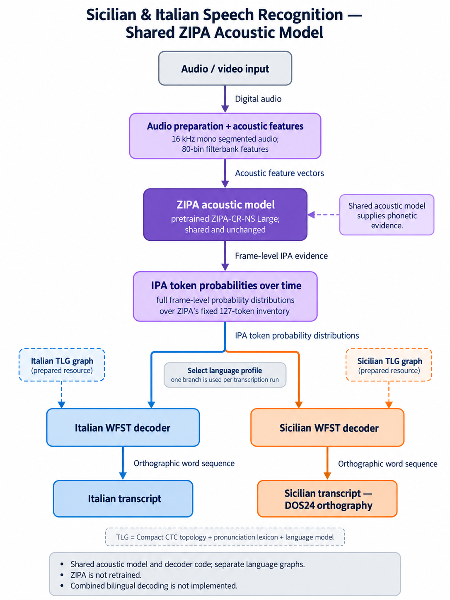

# Sicilian ASR

A local speech pipeline: **media → audio segments → IPA probabilities → WFST words → evaluation**.

Italian and Sicilian decode on CPU through separate language resources and graphs. Italian uses PhonItalia and the pretrained MLS trigram; the [Sicilian POC](src/asr/scn/README.md) trains a small KenLM model from reviewed text and channel captions. The combined Italian–Sicilian graph remains future work.

## Pipeline architecture

Italian and Sicilian share the ZIPA acoustic model and WFST decoding engine, with separate pronunciation resources, language models, and decoding graphs.



See the [architecture documentation](docs/architecture.md) for implementation details.

## Pipeline performance

Measured on **2026-10-12** using CPU on macOS ARM64. Word error rate (WER) and character error rate (CER) measure transcription errors; lower is better.

| Pipeline | Held-out evaluation | WER | CER |
| --- | --- | ---: | ---: |
| Italian | 202 recordings of 18 repeated acted sentences | **17.47%** | **6.73%** |
| Sicilian POC | Two YouTube videos, 2,120 reference words | **71.60%** | **32.21%** |

These are different, limited evaluation sets, so the scores are not a direct language comparison. Sicilian runs end to end, but accuracy is not yet reliable for general transcription: **18.02% of reference words are outside its vocabulary**. Pronunciations remain provisional, and the caption references include foreign quotations and may differ from the audio.

For **17.2 minutes of Sicilian audio**, acoustic inference took **44.3 seconds** and decoding took **21.4 seconds**, with **2.51 GiB peak process memory**. These stage timings exclude acquisition and graph construction and were measured during concurrent validation, not an isolated speed benchmark.

See the [Italian results](src/asr/ita/docs/validation.md) and [Sicilian results](src/asr/scn/docs/poc.md) for the evaluation setup, model sizes, and remaining limitations.

## Run Italian ASR

The pinned environment targets **macOS ARM64 and Python 3.12**. Install FFmpeg/FFprobe and Apple's Command Line Tools first; see [setup details](docs/dependencies.md).

```sh
uv sync --frozen --extra research --extra corpus
.venv/bin/sicilian-asr prepare --config ita
.venv/bin/sicilian-asr transcribe --config ita \
  --input recording.mp4 --reference subtitles.srt --output outputs/example
```

The reference is optional; supported formats are SRT, VTT, and UTF-8 text. Use a new output directory for each run. `prepare` acquires and verifies resources and builds a graph; `transcribe` uses local resources only. Add `--diagnostics` to export original probabilities and competing-path diagnostics. `python -m pipeline` exposes the same commands.

A run writes `transcription.txt`, `ipa_greedy.txt`, `segments.json`, `run_metadata.json`, and evaluation files including `metrics.json`. IPA is a diagnostic, and timestamps describe segments rather than word alignment.

## Find your way around

| Start here | What it explains |
| --- | --- |
| [Architecture](docs/architecture.md) | Layers, dependencies, and source/test layout |
| [Italian ASR](src/asr/ita/README.md) | Preparation, pronunciation rules, settings, and benchmarks |
| [Sicilian ASR](src/asr/scn/README.md) | POC training, transcription, DOS24 review and measured results |
| [Resource integrity](docs/resources.md) | Manifests, downloads, receipts, and layout migration |
| [Validation](docs/validation.md) | Fresh test, environment, and real-audio results |

Language settings and resources live beside their code. Shared defaults are in [common/settings.py](src/common/settings.py). `--config` accepts `ita`, `scn`, `ita_scn`, or a YAML override file.

## Development

```sh
.venv/bin/python -m pytest -q
.venv/bin/python scripts/validate_environment.py --acoustic
.venv/bin/python scripts/validate_resources.py --strict --config ita
```

Tests mirror the source layers. After updating from the old layout, run `scripts/migrate_layout.py --apply` before preparation; see [migration instructions](docs/resources.md#migration).

Code is MIT. Model and dataset terms are separate; see [resource licensing](docs/resources.md) and [third-party notices](docs/third-party-notices.md).
