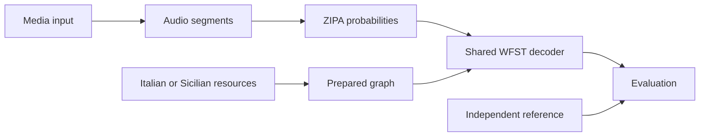

# Architecture

`pipeline` connects media input, segmentation, acoustic inference, language preparation, decoding and evaluation. Source packages remain independent top-level imports; the distribution and CLI are named `sicilian-asr`.

| Package | Responsibility |
| --- | --- |
| `common` | Defaults, paths, resource verification and small shared utilities |
| `media_input` | FFmpeg extraction, uploaded-caption acquisition and reference parsing |
| `audio` | Sample-exact segmentation; no gaps or overlaps |
| `ipa` | ZIPA, tokenizer inventory, validated frame distributions and diagnostics |
| `asr.wfst` | ARPA restriction, graph composition, cache verification and search |
| `asr.ita` | Italian lexicon conversion, vocabulary, graph preparation and scoring |
| `asr.scn` | Source acquisition, extraction/review, LM training, pronunciation and scoring |
| `evaluation` | Edit counts, WER/CER and comparison output |
| `pipeline` | CLI, configuration assembly and cross-layer workflows |

Tests mirror these packages. `common` imports no higher layer. Media, audio, IPA and evaluation do not import a language implementation. WFST code depends on IPA contracts; the two languages do not import each other. Only `pipeline` coordinates them. Scripts are small wrappers around the owning modules.

## Contracts

Media extraction produces mono 16 kHz audio and timestamp metadata. Segments use sample offsets. ZIPA returns finite, normalized CPU log probabilities with valid lengths and its fixed token inventory; exported probabilities retain original frames. Language preparation supplies the lexicon, word table and ARPA model to shared graph construction.

Transcription references enter evaluation only. Sicilian development references select models/settings; final captions supply only a fixed overlap denylist before final scoring. No reference proposes decoder candidates. Strict WER uses whitespace tokens; CER excludes whitespace. Without an IPA reference, phoneme error rate is unavailable.

## Compact CTC

The topology and tensor construction follow [Laptev et al. (2022)](https://www.isca-archive.org/interspeech_2022/laptev22_interspeech.pdf) and its [NeMo implementation](https://github.com/NVIDIA/NeMo/blob/v1.23.0/nemo/collections/asr/parts/k2/topologies.py). This is not k2's `modified=True` topology.

The initial hub emits each acoustic label to its own state, including a separate blank state. Each such state can self-loop on that label with epsilon output or return to the hub on a decoder-only auxiliary label. Only the hub has a final transition. Separating the blank state prevents a neutral frame following a real blank from emitting a new phone. In ZIPA, blank remains ID 0, auxiliary input is 127, and lexicon disambiguators begin at 128. FST output epsilon uses 0; this is distinct from consuming an acoustic blank on the input side.

The adapter creates a new tensor with twice as many frames and one extra column. Even frames contain the original scores (times the acoustic scale), with auxiliary probability zero (`-inf` log score). Odd frames contain zero log score for every column. Valid lengths double. Original matrices and optional exports are unchanged. The neutral scores are not renormalized: they implement transitions, not new acoustic evidence.

Compact CTC is not ordinary greedy CTC. In particular, two consecutive identical acoustic labels can yield one or two output labels, depending on self-loop versus auxiliary return. Blank-separated identical labels yield two labels. The tests explicitly preserve this published distinction and check final-frame termination.

## Static composition and weights

The lexicon permits one optional `▁` at segment start. Its word loop never inserts a boundary between phones or words. Distinct pronunciations are preserved. Optional Italian compatibility rules add doubled-consonant and prevelar-nasal alternatives and derive MLS-attested `l'`/`c'` contractions before vocabulary selection; their provenance is recorded separately from the source audit. Homophones and pronunciations that prefix another pronunciation receive disambiguators; `#0` propagates grammar backoff. `<unk>` maps to acoustic ID 2.

`kaldilm==1.15.4` compiles the restricted original ARPA to OpenFst text with `#0` backoff. k2 imports costs as natural-log scores. Following [Icefall's pinned recipe](https://github.com/k2-fsa/icefall/blob/c1eda5427c46502b2cfdcbeb910bf35f2134a0d4/egs/librispeech/ASR/local/compile_hlg.py), composition performs `L∘G`, connection, determinization, disambiguator removal, epsilon removal, connection/arc sorting, then `T∘LG`. Intermediate graphs, word/token tables, restricted ARPA, audits, and stage statistics remain cached.

The graph uses tropical best-path backoff as in the Icefall recipe. Controlled fixtures compare resulting path scores against KenLM, including sentence boundaries, unknowns, and missing n-grams. This does not establish equivalence for every arbitrary ARPA: epsilon backoff paths can compete with explicit n-grams under tropical decoding. Original weights are preserved; no word insertion penalty, LM training, pruning, or renormalization is added.

The original defaults were acoustic/LM scales 1/1, search/output beams 20/8, and active-state bounds 30/10000; [Italian settings](../configs/ita.yaml) records the active settings. LM scale is baked into `G` and therefore changes the cache key; runtime acoustic scale acts only inside the frame adapter. Search consumes complete distributions through `k2.DenseFsaVec`, `intersect_dense_pruned(allow_partial=False)`, and shortest-path word recovery. Callers processing many recordings can retain a one-element graph vector, avoiding a multi-GB graph copy for every call.

Every decoded segment records the chosen pronunciation and separates its scaled acoustic score from its scaled grammar score. `--diagnostics` additionally samples 32 lattice paths with a fixed seed, includes the actual best path, and retains the highest sampled path score per distinct sentence. These are competing sampled paths, not exact N-best sentence scores or confidence estimates. Diagnostic mode exports original probabilities and includes OOV causes; references never enter candidate generation.

## Integrity and runtime state

Preparation fingerprints original resources, settings, rule versions, dependencies and relevant implementation files. Prepared artifacts have checksums; incomplete or changed caches fail verification. Native graph compilation runs in an isolated process so an abort cannot leave a successful receipt. Each decoding workflow loads one reusable graph vector and word table.

`src` contains Python only. `configs` owns runtime settings; `resources` owns manifests, catalogs and review inputs; `docs` owns guides and measured evidence. Large inputs/intermediates remain in `.cache`, and individual runs in `outputs`. See [configuration](usage.md#configuration) and [resource integrity](resources.md).

The supplied [CLiC-it paper](93_main_long.pdf), Sections 3.3/4.1, motivates the static Compact CTC–lexicon–trigram structure. This project uses ZIPA/PhonItalia/MLS and does not reproduce that paper's trained models or experiments.
