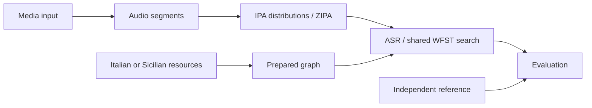

# Pipeline architecture

Read the code in the order data moves through it. `pipeline` connects the stages; each stage owns its implementation and contracts.

## Directory map

| Source directory | Owns | Corresponding tests |
| --- | --- | --- |
| [media_input](../src/media_input/README.md) | Media extraction and reference parsing | `tests/media_input` |
| [audio](../src/audio/README.md) | Sample-exact segmentation | `tests/audio` |
| [ipa](../src/ipa/README.md) | ZIPA, token inventory, frame distributions | `tests/ipa` |
| [asr/wfst](../src/asr/wfst/README.md) | Shared ARPA, graph composition, CTC search | `tests/asr/wfst` |
| [asr/ita](../src/asr/ita/README.md) | Italian lexical preparation and scoring policy | `tests/asr/ita` |
| [asr/scn](../src/asr/scn/README.md) | Sicilian corpus review, LM training, lexicon and preparation | `tests/asr/scn` |
| [evaluation](../src/evaluation/README.md) | Edit counts and comparison output | `tests/evaluation` |
| [common](../src/common/README.md) | Settings, utilities, resource integrity | `tests/common` |
| [pipeline](../src/pipeline/README.md) | CLI, configuration assembly, orchestration | `tests/pipeline` |

There is no enclosing Python package under `src`. The distribution and console command remain named `sicilian-asr`. Import modules by layer, such as `ipa.types` or `asr.wfst.compact`.

## Dependency boundaries

`common` imports no pipeline layers. Media input, audio, IPA, and evaluation depend on common utilities, not on a language implementation. Shared WFST code consumes IPA contracts; it does not import Italian or Sicilian code. The two language directories remain independent. `pipeline` coordinates them. Tests enforce these boundaries.

Language preparation supplies pronunciations, vocabulary, and an ARPA grammar to shared WFST code. Both monolingual profiles are implemented. Language adapters supply Italian number verbalization or Sicilian strict orthographic normalization to shared evaluation.

For transcription, reference parsing is part of media input and references enter only evaluation. In the separate Sicilian training study, development references select among train-only vocabularies and decoder settings. Final references are reserved for scoring, apart from an automatic duplicate-exclusion screen.

## Entry points and data

`pipeline.cli:main` serves both `sicilian-asr` and `python -m pipeline`. Files in `scripts/` are small command wrappers around the owning modules. Native graph compilation runs through `python -m asr.wfst` in an isolated process.

Language configuration, manifests, research evidence, and contextual documentation are co-located under each language. Large downloads and generated graphs stay in `.cache`; run outputs stay in `outputs`. [Configuration assembly](../src/pipeline/README.md#configuration) and [resource migration](resources.md#migration) explain the details.

The supplied [CLiC-it paper](93_main_long.pdf), Sections 3.3/4.1, motivates the static Compact CTC–lexicon–trigram structure. This project uses ZIPA/PhonItalia/MLS and does not reproduce that paper’s trained models or experiments.
