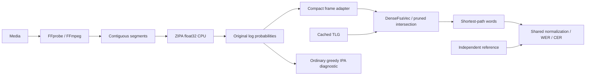

# Italian decoding architecture

`python -m sicilian_asr prepare` owns resource acquisition and graph compilation. `transcribe` performs local-only verification, acoustic inference, decoding, and evaluation. No reference text enters preparation, vocabulary selection, or search.

## Component contracts

| Component | Responsibility |
| --- | --- |
| `resources.py` | Atomic HTTPS downloads, Git/SHA-256/MD5 checks, safe source extraction, named academic archive members and derived receipts |
| `lexicon/prepare.py` | Exact 127-ID inventory validation and auditable PhonItalia conversion |
| `lm/prepare.py` | Streaming ARPA inspection, deterministic vocabulary selection, retained-weight restriction |
| `preparation.py` | Resource provenance, compilation subprocess, cache identity and hash verification |
| `decoding/graph.py` | Disambiguated lexicon, established kaldilm conversion, static graph composition |
| `audio.py` | FFprobe stream metadata, FFmpeg 16 kHz mono extraction, sample-exact segment partition |
| `acoustic/zipa.py` | Strict upstream checkpoint loading, Lhotse Fbank, full frame distributions and valid lengths |
| `decoding/compact.py` | Compact topology, private frame expansion, k2 search, word recovery |
| `evaluation.py`, `text.py` | Cue parsing, shared normalization, alignment counts, separate OOV reports |
| `spoken.py` | Independent, versioned Italian cardinal verbalization for additive spoken-form metrics |
| `pipeline.py` | Sequential orchestration, stage timings, artifacts, failed-run diagnostics |

Acoustic outputs contain ordered tokens, blank ID, feature/preprocessing metadata, float32 CPU natural-log probabilities `[batch, frames, vocabulary]`, and integer valid lengths. All probabilities must be finite; valid frames must sum to one in probability space. Empty/invalid lengths, incompatible inventories, unsupported devices, and empty/nonfinite lattices are errors. Greedy IPA never replaces a failed WFST result.

## Compact CTC

The topology and tensor construction follow [Laptev et al. (2022)](https://www.isca-archive.org/interspeech_2022/laptev22_interspeech.pdf) and its [NeMo implementation](https://github.com/NVIDIA/NeMo/blob/v1.23.0/nemo/collections/asr/parts/k2/topologies.py). This is not k2's `modified=True` topology.

The initial hub emits each acoustic label to its own state, including a separate blank state. Each such state can self-loop on that label with epsilon output or return to the hub on a decoder-only auxiliary label. Only the hub has a final transition. Separating the blank state prevents a neutral frame following a real blank from emitting a new phone. In ZIPA, blank remains ID 0, auxiliary input is 127, and lexicon disambiguators begin at 128. FST output epsilon uses 0; this is distinct from consuming an acoustic blank on the input side.

The adapter creates a new tensor with twice as many frames and one extra column. Even frames contain the original scores (times the acoustic scale), with auxiliary probability zero (`-inf` log score). Odd frames contain zero log score for every column. Valid lengths double. Original matrices and optional exports are unchanged. The neutral scores are not renormalized: they implement transitions, not new acoustic evidence.

Compact CTC is not ordinary greedy CTC. In particular, two consecutive identical acoustic labels can yield one or two output labels, depending on self-loop versus auxiliary return. Blank-separated identical labels yield two labels. The tests explicitly preserve this published distinction and check final-frame termination.

## Static composition and weights

The lexicon permits one optional `▁` at segment start. Its word loop never inserts a boundary between phones or words. Distinct pronunciations are preserved. Optional Italian compatibility rules add doubled-consonant and prevelar-nasal alternatives and derive MLS-attested `l'`/`c'` contractions before vocabulary selection; their provenance is recorded separately from the source audit. Homophones and pronunciations that prefix another pronunciation receive disambiguators; `#0` propagates grammar backoff. `<unk>` maps to acoustic ID 2.

`kaldilm==1.15.4` compiles the restricted original ARPA to OpenFst text with `#0` backoff. k2 imports costs as natural-log scores. Following [Icefall's pinned recipe](https://github.com/k2-fsa/icefall/blob/c1eda5427c46502b2cfdcbeb910bf35f2134a0d4/egs/librispeech/ASR/local/compile_hlg.py), composition performs `L∘G`, connection, determinization, disambiguator removal, epsilon removal, connection/arc sorting, then `T∘LG`. Intermediate graphs, word/token tables, restricted ARPA, audits, and stage statistics remain cached.

The graph uses tropical best-path backoff as in the Icefall recipe. Controlled fixtures compare resulting path scores against KenLM, including sentence boundaries, unknowns, and missing n-grams. This does not establish equivalence for every arbitrary ARPA: epsilon backoff paths can compete with explicit n-grams under tropical decoding. Original weights are preserved; no word insertion penalty, LM training, pruning, or renormalization is added.

The original defaults were acoustic/LM scales 1/1, search/output beams 20/8, and active-state bounds 30/10000; `configs/ita.yaml` records the active settings. LM scale is baked into `G` and therefore changes the cache key; runtime acoustic scale acts only inside the frame adapter. Search consumes complete distributions through `k2.DenseFsaVec`, `intersect_dense_pruned(allow_partial=False)`, and shortest-path word recovery. Callers processing many recordings can retain a one-element graph vector, avoiding a multi-GB graph copy for every call.

Every decoded segment records the chosen pronunciation and separates its scaled acoustic score from its scaled grammar score. `--diagnostics` additionally samples 32 lattice paths with a fixed seed, includes the actual best path, and retains the highest sampled path score per distinct sentence. These are competing sampled paths, not exact N-best sentence scores or confidence estimates. Diagnostic mode exports original probabilities and includes OOV causes; references never enter candidate generation.

## Caching, diagnostics, and timing

A content-addressed directory includes source resource hashes/revisions, original ARPA hash, normalization versions, vocabulary limit, pronunciation/contraction options, graph settings, package versions, and compiler source hashes. Every prepared artifact has a SHA-256. Stale or changed artifacts are rejected; no timestamp-only cache reuse is permitted. Native graph compilation runs in a subprocess so a native failure leaves a failed preparation receipt rather than a success marker.

Transcription writes running metadata before inference and marks complete only after writing/evaluating outputs. Python failures retain the failing stage and traceback. Abrupt process termination can leave `running` metadata, which is not a completed run. Nonempty output directories are rejected to avoid mixing old success artifacts with a new attempt.

FFprobe records the selected absolute stream index, stream and container durations, and timestamp origin. FFmpeg decodes/downmixes/resamples without amplitude normalization. Consecutive segment offsets partition the extracted samples with no overlap or gaps. The search window begins four seconds before the 20-second target and ends at the 24-second maximum. Silence runs of at least 300 ms below −40 dBFS are preferred by proximity to target; otherwise the lowest-energy 10 ms frame is selected and the cut is flagged. Source times are sample offsets plus stream origin; this does not repair discontinuous media timestamps or subtitle synchronization.

The acoustic model loads once per run; inference and decoding process one segment at a time. Metadata records stage wall times, segment frame lengths, lattice size, versions, configuration, resource/graph/output hashes, audio duration, and process peak RSS. Full-file extraction currently holds the waveform in memory, so very long recordings also incur audio-buffer memory.
